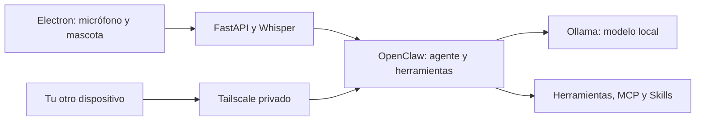

# Solobino: revisión técnica y modelo local

**Actualización posterior:** se implementó la conversación directa con Ollama y
streaming en la mascota. El estado actual, alcance y mediciones se describen en
`voice-backend/README.md`. El resto de este informe conserva el diagnóstico inicial.

Revisión: 11 de septiembre de 2026. Se inspeccionó código, dependencias instaladas,
hardware y el protocolo de la versión local de OpenClaw. Los errores del producto
se documentaron; no se modificaron sus archivos Python ni Electron.

## Qué hace el proyecto

La mascota Electron captura micrófono en WebM/Opus. FastAPI recibe los segmentos,
Whisper los transcribe y OpenClaw ejecuta el agente. Existe una CNN propia ONNX
para detectar «Solobino», pero está desactivada **por defecto** en código
(`WAKEWORD_USE_CNN=false`; el `.env` puede sobrescribirlo). La interfaz muestra
texto y animaciones; no hay síntesis de voz implementada en este repositorio.
La animación «hablando» no representa audio generado.



## Hallazgos priorizados

### P1 — Control del PC sin autenticar y entrada directa al shell

`voice-backend/main.py:324` acepta el WebSocket sin validar identidad ni Origin;
`main.py:1072` permite `control_pc`. `agentic_control.py:43` interpola `app_name`
en `os.system("start ...")`. Una entrada con metacaracteres llega al shell.
Se confirmó con un `os.system` simulado, sin ejecutar comandos del PC.

El arranque actual usa loopback: esto reduce exposición de red, pero no agrega
autenticación. Publicar ese puerto convertiría el problema en acceso remoto al
PC. CORS no autentica WebSockets. Corregir con autenticación, validación de
Origin, esquema de mensajes, lista de aplicaciones permitidas y lanzamiento
sin shell. Las herramientas deberían ejecutarse en un único componente con
permisos explícitos, evitando el atajo paralelo `control_pc`.

### P1 — Se pierde el inicio del comando tras la palabra de activación

`desktop-ui/renderer.js:560` captura ventanas de 3 segundos para detectar el wake
word. El backend consume ese audio y devuelve solo `wake_word_detected`
(`main.py:1053`, `main.py:1067`). La UI empieza **otra** grabación después
(`renderer.js:427`). Si dices «Solobino abre…» en la misma ventana, «abre…» ya fue
pronunciado y se descarta. El comentario de «graba de inmediato» no resuelve ese
desfase. Mantener un buffer de audio con pre-roll y transferir la parte posterior
al wake, o extraer el comando de la misma captura.

### P1 — El streaming no coincide con OpenClaw instalado

`voice-backend/main.py:764` espera `payload.delta`. OpenClaw **2026.5.7**, instalado
en esta PC, emite `state: "delta"` con el texto **acumulado** en
`payload.message.content[].text`. Su módulo `dist/server-chat--Kkx0ZcY.js:339`
confirma ese formato. Al pasar un evento de ese formato al parser, devuelve
`(None, None)`: la UI espera hasta el final. El fallback HTTP además usa
`stream: false` (`main.py:610`).

Procesar snapshots acumulados y reemplazar el texto visible, o calcular diferencias
por `runId`; concatenar snapshots duplicaría el contenido. Filtrar `sessionKey`,
correlacionar solicitudes y manejar final/error/aborted. Agregar SSE al fallback
HTTP si debe mantener respuesta progresiva.

### P1 — El arranque documentado no corresponde al repositorio

`start-gateway.ps1:15` busca `backend_agente/.env`, pero la carpeta actual es
`voice-backend`. Además, el script local contiene un token literal en vez de
extraer el valor de la línea que leyó. No se reproduce aquí ese secreto.
El README también menciona `animaciones_chilemorron-main` y `wakeword_model`.
El script y el README de raíz están excluidos de Git: un clon no recibe esas
instrucciones. Corregir rutas, leer realmente el token, versionar documentación
y una plantilla `.env.example` sin credenciales. Evaluar rotar el token si se
compartió; no se cambió durante esta revisión.

### P2 — Temporizadores de grabaciones anteriores afectan a las siguientes

`renderer.js:491` deja vivo el límite de 20 segundos tras terminar una grabación
por silencio. Su callback usa las variables globales `isRecording` y
`mediaRecorder`. Si otra grabación empezó antes de que venza el temporizador
anterior, este detiene la nueva. El temporizador del wake también usa un recorder
global. Guardar/cancelar cada timer y capturar la instancia de su grabación.

### P2 — El watchdog desaparece al primer fragmento

`renderer.js:382` cancela el watchdog al recibir el primer delta. Si el streaming
se interrumpe después, la mascota puede quedar en `talk`, estado que impide
reactivación. `onclose` no termina el turno. Usar timeout por inactividad del
stream, cancelación de turno y recuperación explícita al desconectar.

### P2 — Respuestas y sesiones mezcladas

`ConnectionManager.broadcast_json` difunde transcripciones, activaciones y
respuestas a todos los clientes. `_listen` no filtra por sesión/run antes de
reenviar eventos. Incluso con un usuario, dos ventanas o una sesión adicional
pueden mezclar contenido. Asociar conexión, solicitud, sesión y run; responder
al solicitante. Los mensajes pendientes WS solo se eliminan en errores, no en
confirmaciones correctas, acumulando texto durante conexiones largas.

### P2 — El fallback GPU no cubre errores al inferir

`main.py:83` cae a CPU si falla el constructor. Si las DLL/CUDA fallan en el warm-up,
la excepción solo se imprime y se devuelve el modelo GPU (`main.py:100`). Las
transcripciones posteriores pueden fallar repetidamente. La recuperación debe
incluir la primera inferencia y actualizar explícitamente el estado del servicio.
Whisper se carga al importar el módulo, dificultando tests y diagnóstico HTTP.

### P2 — Falsos positivos y filtro de silencio mal interpretado

La prueba aislada confirma `_is_wake_word("solo vino") == True`: el fuzzy matching
vuelve a aceptar una frase que los comentarios del regex dicen excluir.
`no_speech_threshold=0.8` está comentado como «más estricto», pero faster-whisper
omite cuando `no_speech_prob > threshold`; subirlo vuelve menos probable ese
descarte, manteniendo lo demás igual. Ajustar con audio real etiquetado.
En el camino CNN se consume el cooldown antes de la confirmación STT: una detección
rechazada puede impedir activar durante los siguientes 8 segundos.

### P2 — Validación y trabajo síncrono dentro del WebSocket

`json.loads` puede producir listas o valores escalares; se llama a `.get` sin
validar el tipo. Base64 inválido puede cerrar la conexión. Faltan límites de
duración de audio, cuotas y validación de parámetros de control. El gate de
energía decodifica audio dentro del event loop, y `type_text` bloquea ese loop
durante 50 ms por carácter. Decodificar una vez fuera del loop, validar mensajes
y ejecutar operaciones bloqueantes en workers con límites y cancelación.

## Optimizaciones con mayor efecto

1. Reparar streaming y conservar audio tras wake. La captura introduce ventanas
   de 3 s, pausas de 200 ms entre ventanas y 1,5 s de silencio para cerrar comando.
   Estos tiempos están en el código; no son un benchmark ni deben sumarse como
   un mínimo fijo de todos los turnos.
2. Medir separadamente fin de habla, cola STT, transcripción, primer token y fin
   del agente. Objetivo inicial: primer texto en menos de 1 s para prompts cortos
   y modelo caliente; es una meta que requiere medir, no una garantía.
3. Evaluar Whisper `small` en GPU/int8_float16 frente a `medium`. Medir exactitud
   en español junto con latencia y VRAM compartida con Ollama.
4. VAD continuo y ventanas solapadas para wake; activar la CNN únicamente después
   de validar falsos positivos por hora y falsos negativos con voces/sesiones
   separadas. El `val_f1=0.955` guardado no demuestra rendimiento en uso real.
5. Mantener un modelo pequeño caliente, concurrencia 1, contexto acotado y
   thinking desactivado para órdenes simples. Evitar cargar todo el catálogo de
   herramientas y todas las Skills en cada turno.
6. Contexto reciente más resumen breve y resultados de herramientas limitados.
   Un modelo local sigue procesando tokens: elimina la factura de inferencia
   externa, no el cómputo. Reducir salida y prompt reduce trabajo; streaming mejora
   la percepción sin reducir por sí mismo el número de tokens.
7. Para acciones simples y frecuentes, un router determinista validado puede
   evitar llamar al LLM. Las acciones sensibles mantienen controles de permisos.

## Hardware y propuesta

- Ryzen 5 5600G, 6 núcleos/12 hilos; aproximadamente 32 GB de RAM.
- RTX 3060 de 12 GB VRAM. El uso cambia con el escritorio, Whisper y otros procesos.
- Ollama 0.33.3; almacenamiento de modelos en `E:\ollama_models`.
- Gemma4 26B y 31B ya descargados: sus capas suman aproximadamente 16,75 y 18,50 GiB.
  Los pesos exceden la VRAM disponible; usar CPU/offload puede comprometer latencia.
- Se eligió Qwen3.5 4B Q4_K_M (~3,4 GB de descarga), con herramientas y thinking
  configurable, para medir una opción que deje espacio a Whisper. El tamaño en
  disco no equivale a VRAM total: faltan contexto, buffers y runtime.

OpenClaw hace el bucle agente, valida/ejecuta herramientas y conecta MCP. Las
Skills son instrucciones/recursos cargados por ese runtime, no funciones nativas
de los pesos. El soporte de formatos no garantiza fidelidad: evaluar instrucciones,
argumentos y resultados de herramientas. Plugins de otras aplicaciones pueden
depender de servidores, autenticaciones o APIs que aquí no existen.

## Archivos preparados y uso

Desde la raíz del repositorio, en PowerShell:

```powershell
.\scripts\start-local-model.ps1
python scripts/benchmark-local-model.py
# Otra terminal: agente aislado del OpenClaw que ya tienes configurado.
.\scripts\start-local-agent.ps1
```

El benchmark usa prompts sintéticos en español, mide primer texto y generación,
y ejecuta una suma validada como herramienta para comprobar el viaje completo.
Guarda `local-model-results/benchmark.json`. No mide todavía la mascota, Whisper,
OpenClaw ni internet. La primera solicitud puede incluir carga del modelo; las
siguientes usan preguntas distintas para no medir solo caché de un prompt idéntico.

El perfil de agente se guarda en `.local-solobino/`, ignorado por Git. Usa puerto
18790, token aleatorio, API HTTP habilitada, contexto 8192 y únicamente `read`
dentro de su workspace de prueba. No modifica `~/.openclaw`, cuyo modelo por
defecto observado era `openai-codex/gpt-5.4`. El token no debe compartirse ni
incluirse en commits. Las futuras ampliaciones de herramientas/MCP requieren
configurar sus permisos y credenciales correspondientes.

Para integrar después la mascota, apuntar su backend a este gateway mediante
`OPENCLAW_GATEWAY_URL`, `OPENCLAW_HTTP_BASE_URL` y su token. El backend sigue
hablando con **OpenClaw** por `/v1/chat/completions`; es OpenClaw quien habla con
**Ollama** por `/api/chat`. Esos dos endpoints no son intercambiables.

Para acceso personal remoto:

```powershell
# Con Tailscale conectado en ambos dispositivos:
.\scripts\serve-local-agent.ps1
```

El script sirve el gateway autenticado en HTTPS 8443 dentro de la tailnet y se
niega a reemplazar un Serve existente en ese puerto. No publica el backend de
voz 8000 ni Ollama 11434. La API HTTP conserva Bearer token; el navegador puede
requerir aprobación de dispositivo/origen en OpenClaw. Limitar el acceso a tus
dispositivos con las reglas de la tailnet. La PC debe permanecer encendida.
Reversión: `tailscale serve --https=8443 off`; detener el gateway con Ctrl+C.

## Verificación realizada

Resultados medidos en esta PC (muestras pequeñas, no equivalen a una garantía):

| Prueba | Primer texto | Tiempo total |
|---|---:|---:|
| Ollama, primera solicitud (incluye 4,11 s de carga) | 4,27 s | 4,56 s |
| Ollama caliente, mediana de 3 preguntas cortas | 0,101 s | 0,50 s de mediana |
| Ollama, función sumar y respuesta final | — | 0,83 s entre ambas llamadas |
| OpenClaw, lectura real, primer turno | 76,38 s | 76,80 s |
| OpenClaw, siguiente turno antes de ajustar perfil | 17,94 s | 18,37 s |
| OpenClaw, primer turno después de recargar perfil reducido | 58,65 s | 59,08 s |
| OpenClaw por HTTPS de Tailscale, lectura real | 23,69 s | 24,14 s |

Ollama produjo ~81–83 tokens/s en las preguntas cortas. La herramienta `sumar`
recibió los argumentos correctos, se ejecutó y el modelo respondió `462`.
OpenClaw leyó correctamente un archivo cuyo valor aleatorio no estaba incluido
en el prompt. HTTPS se verificó desde la propia PC, no desde un teléfono externo.

**El agente completo todavía no cumple latencia casi instantánea.** Las trazas
de OpenClaw muestran decenas de segundos en resolución/autenticación y preparación
de herramientas, además de bloqueos del event loop. El perfil reducido no resolvió
esa demora en esta prueba. Las llamadas al modelo del agente siguen teniendo
aproximadamente 7.600–7.700 tokens de entrada, frente a 33–36 en las preguntas
directas. El problema no es únicamente qué modelo se elige.

Se dejaron heartbeat desactivado, `localModelLean=true` y plugin allowlist de
Ollama en el perfil aislado. Esto evita consultas periódicas y limita componentes;
no se atribuye una mejora de latencia que las mediciones no demostraron. Un siguiente
trabajo debe perfilar el coste repetido de descubrimiento/carga en OpenClaw o
implementar una ruta directa y acotada para comandos frecuentes, conservando
OpenClaw para tareas complejas. No se modificó la instalación global del gateway.

El acceso privado activo es `https://walter-pc.tail8db8b3.ts.net:8443/`.
El API requiere el token de `.local-solobino/openclaw.json` (`gateway.auth.token`).
Para el panel web, pegar ese token en su configuración de conexión; puede pedir
emparejar el dispositivo. Los orígenes permitidos incluyen exactamente ese HTTPS
y el acceso local. No se probó la interfaz web en otro dispositivo ni se instaló
un servidor MCP concreto. Se verificó soporte documental y llamadas a herramientas.

Los datos completos están en `local-model-results/benchmark.json`,
`agent-probe-initial.json`, `agent-probe-warm-before.json`, `agent-probe.json` y
`agent-probe-remote.json`. Para repetir la lectura: `python scripts/probe-local-agent.py`
o `python scripts/probe-local-agent.py --remote`.

Para dejar el gateway fuera de la terminal: `.\scripts\start-local-agent.ps1 -Background`.
Ollama y el gateway deben estar activos; estos scripts no instalan arranque automático
con Windows. Para detener el gateway en segundo plano, identificar el proceso
propietario del puerto 18790 y detener solo esa instancia.

- Sintaxis Python y `node --check` en ambos JS: correcta. Esto no prueba ejecución.
- Parser de evento acumulado: fallo reproducido de forma aislada.
- Falso wake «solo vino»: reproducido de forma aislada.
- Entrada al shell: reproducida usando mocks, sin ejecutar comandos.
- Configuración aislada: `openclaw config validate` la aceptó.
- El ONNX cargó con CPUExecutionProvider y produjo una salida finita con entrada
  sintética. Esto valida carga/inferencia, no su precisión de detección.
- API autenticada: la solicitud sin token devolvió 401; health local y HTTPS
  privado devolvieron 200. La lectura por HTTPS con token terminó correctamente.
- No se capturó micrófono, no se entrenó/reemplazó el ONNX ni se ejecutaron acciones
  reales de control del PC. Falta una prueba completa de voz con hardware real.

## Fuentes oficiales consultadas

- [Qwen3.5 4B en Ollama](https://ollama.com/library/qwen3.5:4b): tamaño y capacidades.
- [Ollama: tool calling](https://docs.ollama.com/capabilities/tool-calling).
- [Ollama: thinking](https://docs.ollama.com/capabilities/thinking).
- [Ollama: streaming](https://docs.ollama.com/capabilities/streaming).
- [OpenClaw: Ollama](https://docs.openclaw.ai/providers/ollama): usar API nativa.
- [OpenClaw: Skills](https://docs.openclaw.ai/tools/skills).
- [OpenClaw: bundles y MCP](https://docs.openclaw.ai/plugins/bundles).
- [Tailscale Serve](https://tailscale.com/docs/features/tailscale-serve): acceso privado.

También se contrastaron las instrucciones con la documentación y el código de
OpenClaw 2026.5.7 instalados, pues la documentación web puede corresponder a una
versión posterior.
